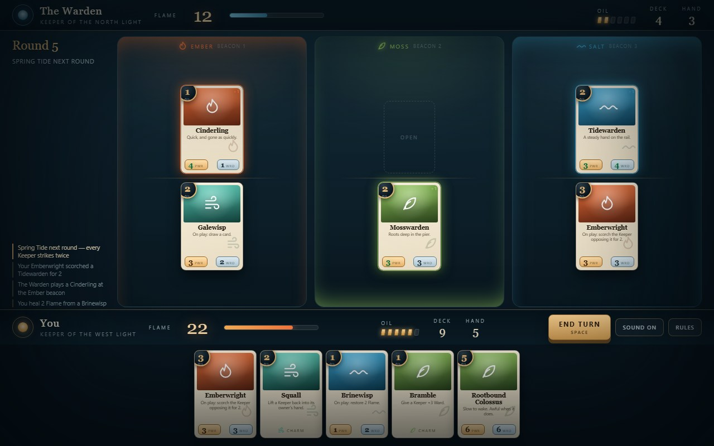
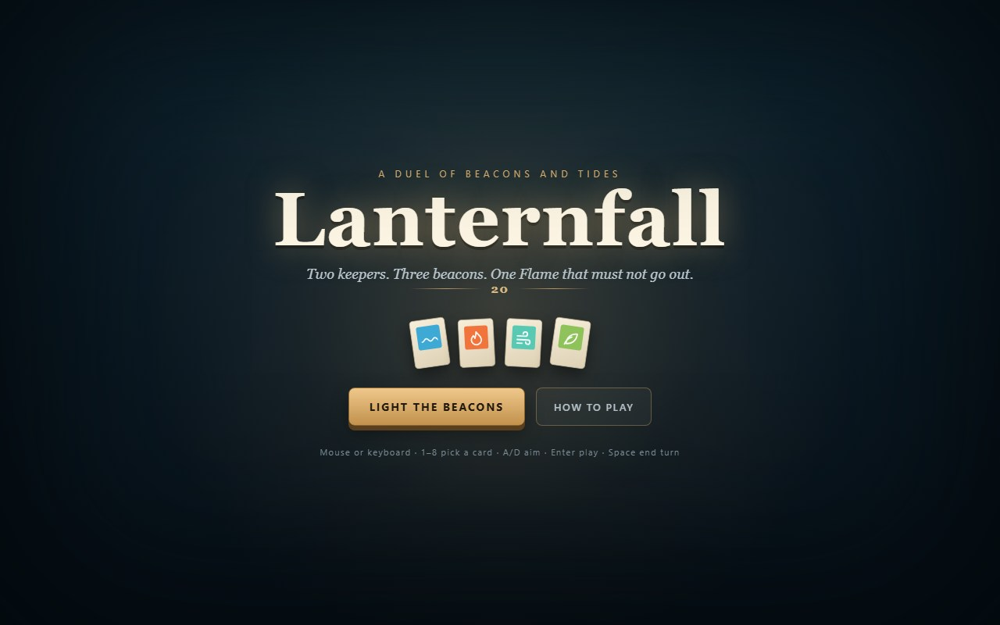
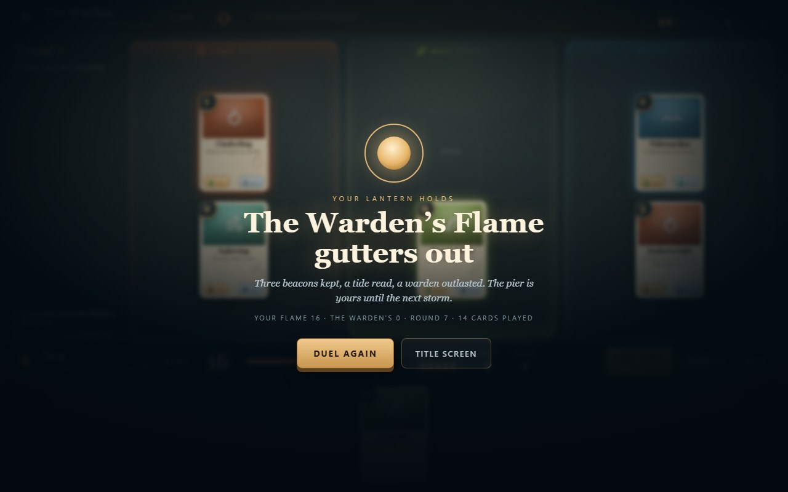
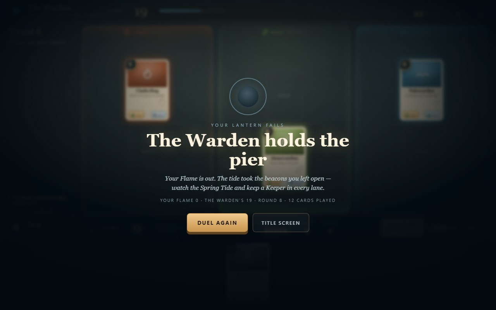

# Lanternfall

[](https://make.fun/bounty/best-card-game-20261122-1826)
[](https://make.fun/bounty/best-card-game-20261122-1826)
[](https://make.fun/bounty/best-card-game-20261122-1826)

*Two keepers. Three beacons. One Flame that must not go out.*

Lanternfall is an original card duel for the desktop browser. You and the Warden each keep one side
of three beacons along a fogbound pier; you place **keepers** into those beacons, they strike across
the rail at whatever faces them, and you spend **Oil** to do it. Both Flames start at 30. Bring the
other keeper's Flame to 0 and the lantern is yours.

No build step, no dependencies, no network requests: it is plain HTML, CSS and ES modules.

Lanternfall is entered in the [make.fun best card game bounty](https://make.fun/bounty/best-card-game-20261122-1826).



## Play

The game loads ES modules, so serve the folder instead of opening the file directly:

```sh
cd game
python -m http.server 8000     # or any static server
# then open http://localhost:8000
```

Press **Light the beacons** on the title screen. **How to play** holds the same rules in-game.

## Rules

1. **Flame is life.** Both keepers begin at 30 Flame. Take the other to 0 to win.
2. **Oil pays for cards.** You gain 1 each turn, up to 10, and it refills at the start of your turn.
3. **Keepers** sit in one of three beacons. At the end of your turn each of your keepers strikes the
   keeper facing it, or the enemy Flame directly when that beacon is open.
4. **Beacon tides.** Every beacon carries a tide (Salt, Ember, Gale, Moss). A keeper whose tide
   matches its beacon's gains +1 Power.
5. **Spring Tide** arrives every third round: every keeper strikes twice. Save your swings for it.
6. **Charms** burn, lift or thicken a keeper. Running your deck dry costs 3 Flame a turn.

The deck is 24 cards: twelve designs, two copies each, across the four tides.

| | |
|---|---|
|  |  |
|  | |

## Controls

| Input | Action |
|---|---|
| Click a card | Pick it up |
| Click a beacon | Play the picked card there |
| `1`–`8` | Pick the card in that hand slot |
| `A` / `D`, arrow keys | Move the keyboard aim between beacons |
| `Enter` | Play the picked card into the aimed beacon |
| `Space` | End your turn |
| `Escape` | Put the picked card down |
| `R` | Duel again after the result |

Mouse and keyboard are both complete; nothing is mouse-only.

## What is in here

```
game/                the game itself, opened in a browser
  index.html         title screen, rules panel, table, result screen
  style.css          the pier's brass-and-lantern look
  src/cards.js       four tides, twelve card designs, the 24-card deck
  src/rules.js       the engine: turn flow, strikes, Spring Tide, deck-out
  src/ai.js          the Warden's one-ply planner
  src/render.js      draws the beacons, rails, hand and log
  src/screens.js     title, briefing and result screens
  src/audio.js       small synthesised chimes (no files)
  src/main.js        controller: mouse and keyboard input, ?shot= screens
  src/shots.js       the fixed table states the screenshots use
screenshots/         the four JPEGs above
main.ts              hand-in program: copies game/ and screenshots/ into /output and writes dossier.json
vendor/makefun-game.ts   the kit's dossier builder, unmodified
```

`main.ts` is the entry the bounty's harness runs (Node 22, standard library only). Locally:

```sh
mkdir -p out && MAKEFUN_OUTPUT_DIR=out node main.ts
```

It refuses to hand in a tree the scorer would refuse (file counts, sizes) instead of letting the
entry be graded blind, then writes `out/dossier.json` describing exactly the files shipped.

## License

MIT — see [LICENSE](LICENSE).
